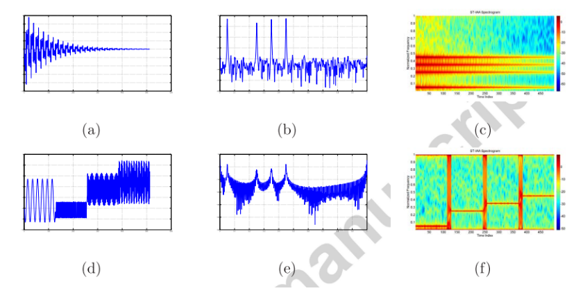
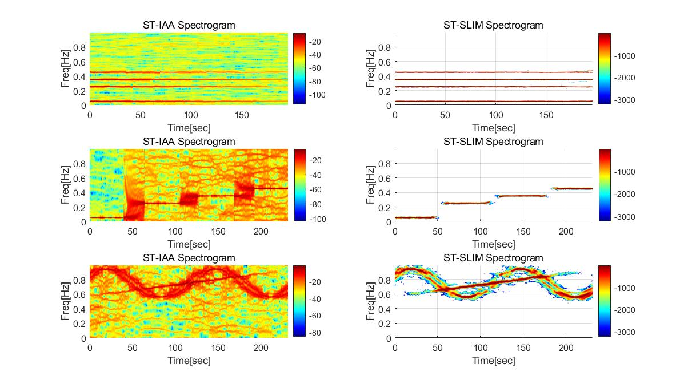
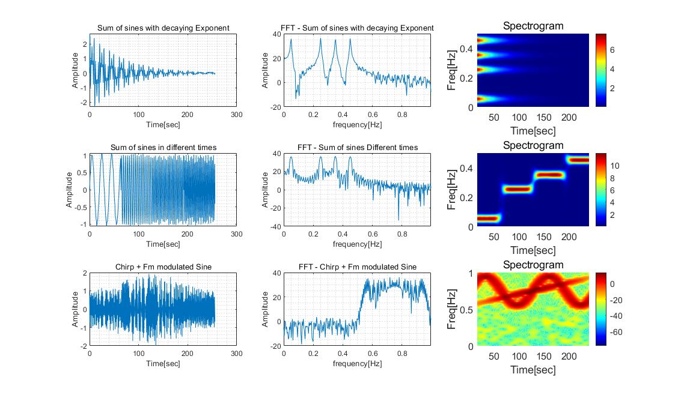
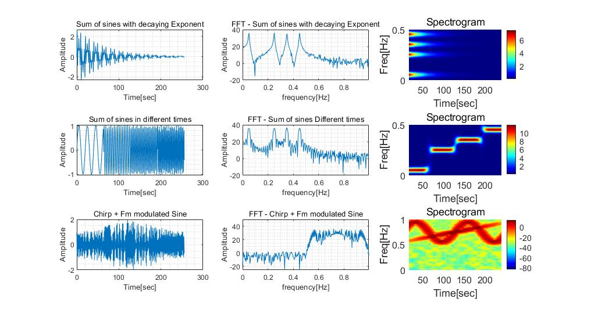
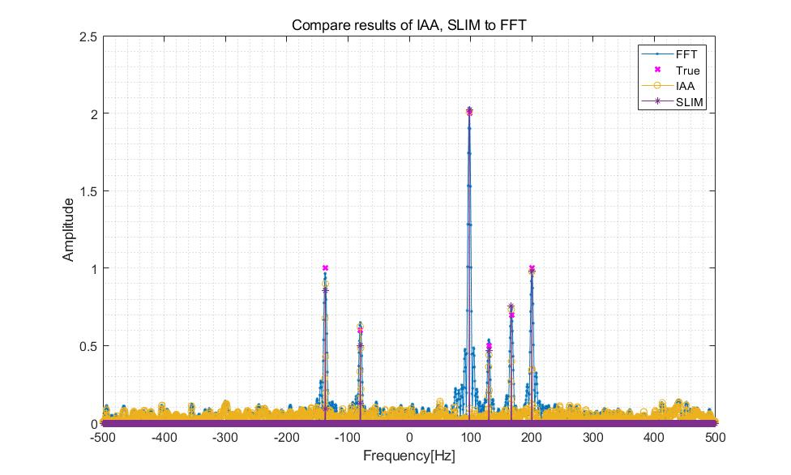

# [Time-Frequency Analysis]Non-stationary Signal's Scalar STFT Time-Frequency Representation under Arbitrary Sampling Method[with MATLAB Code]

Introduction In the field of signal processing, two classic signal representation methods are Time-Domain Representation (TDR) s(t) and Frequency-Domain Representation (FDR) S(f), where variables t and f are considered as mutually exclusive: to have a representation for one variable, another is "integrated" [1]. Therefore, FDR essentially averages TDR values over all time, while TDR essentially averages FDR values over all frequencies [2].
TDR and FDR both have inherent limitations when dealing with non-stationary signals, as these signals have dynamic frequency components that change over time. Thus, univariate representations, namely TDR and FDR, cannot provide comprehensive analysis of these dynamic frequency components [3]. A clear and effective solution is the use of bivariate functions and a new representation ρ(t, f), namely Time-Frequency Representation (TFR), which can simultaneously analyze signals in both the time domain and frequency domain [1].
TFR analyzes the frequency components of a signal at a given time. It combines time-domain and frequency-domain analysis to produce a potential more revealing picture of the time position of signal spectral components [4]. As an example, consider two synthetic non-stationary signals (detailed introduction in Section 3.2), shown in Figures 1(a) and 1(d). Although very different in the time domain, they almost share the same frequency spectrum components with FDR (see Figures 1(B) and 1(E)). Compared to TDR and FDR, TFR (see Figures 1(C) and 1(F)) not only shows the start and end times and frequency range but also reflects the variation of frequency over time.
Generally, TFR has found effective applications in various fields dealing with non-stationary signals, including radar (sonar) [5, 6], biomedicine [7], seismology [8], telecommunications [9] etc. The classic TFR for non-stationary signals can be divided into two categories: (1) linear representations, which include Short Time Fourier Transform (STFT) and Wavelet Transform (WT), and (2) quadratic (bilinear) representations, which include Wiener Distribution (WD) and Fuzzy Function (AF). The STFT assumes that the signal is locally stationary within a short time window. Due to severe leakage of power spectrum estimation by FFT in each window, the spectral plot based on STFT always suffers from high sidelobes and low frequency resolution. The introduction of scaling factors in WT reduces frequency resolution at higher frequencies while reducing time resolution at lower frequencies.
The concept of scaling leads to a good mathematical structure without physical evidence to assume it corresponds to the actual time-frequency structure itself [12]. In contrast, WD and AF can provide higher TFR resolution. However, the presence of cross terms may blur real signal characteristics, hinder time-frequency analysis, and make distribution interpretation difficult [13, 11, 14].
Figure 1: Representation of non-stationary signals: (a) and (d) are the TDR (amplitude) of two synthetic signals; (B) and (d) show the corresponding FDR with the most advanced IAA [15]; while (c) and (e) display the TFR with the most advanced ST-IAA [13].
The main drawback of almost all existing techniques for Time Frequency Representation (TFR) of non-stationary data is their limited applicability, as they only work with signals that are uniformly sampled and free from any (or a little) interference or defects. However, complete data sequences with uniform sampling are always ideal data scenarios. In practical applications, missing data is an important issue where the collection of data may be interfered or incomplete [16]. For example: time series analysis often suffers from data missingness, which prevents the use of traditional TFR methods [17]. Moreover, non-uniformly sampled signals are also frequently encountered in economics, earthquakes, and astronomy, possibly due to various reasons, including random sampling times and deterministic design sampling patterns.
Previous works [12, 19, 20] have mainly focused on improving frequency resolution or balancing the trade-off between frequency and time resolution in uniformly sampled data. However, there has been very little research on TFR methods for arbitrary non-uniformly sampled data or missing data. Due to their excellent performance in power spectral density (PSD) estimation, integrating advanced data-dependent PSD estimation methods under the STFT framework to provide more accurate spectrograms has always been particularly interesting. APES [21] and IAA [15] have recently been extended to handle time-varying signals. It is worth noting that IAA applies a weighted least squares strategy for spectrum estimation, which is robust to sampling times, so the resulting based-STIAA [13] spectrograms can be used for both uniform and non-uniform sampling as well as arbitrary data sampling patterns [22].
Inspired by ST-IAA, our method also fundamentally integrates the most advanced data-dependent PSD estimation algorithms within the STFT framework. In our approach, we successfully introduce another state-of-the-art non-parametric method, namely, Sparse Learning via Iterative Minimization (SLIM), for PSD estimation of signals within each time window. We refer to this novel adaptive TFR method as Short-Term Sparse Learning via Iterative Minimization (ST-SLIM). Additionally, to enhance the performance of the algorithm in scenarios with missing data, we propose Short-Term Missing Data Iterative Adaptation (ST-MIAA) for adaptive TFR of signals with data loss.
The remainder of this paper is organized as follows. Section 2 introduces some preliminary knowledge, including TFR using STFT, PSD estimation with state-of-the-art nonparametric data-dependent methods, and various signal sampling schemes. Section 3 elaborates on the main issues discussed in this paper and presents our experimental data. Section 4 introduces ST-SLIM inspired by ST-IAA. Following this, Section 5 further studies TFR for signals with arbitrary sampling patterns under missing data, proposing ST-MIAA to address this issue. The experimental results are explained in Sections 4 and 5. This paper concludes in Section 6.
MATLAB simulation results
\n        \n  
\n        \n  
\n        \n  

## Images

<!-- PAYMENT_BLOCK -->

## Get this dataset

- Payment link (Stripe): [Buy now](https://buy.stripe.com/3cs8yP7sY87d0vu9AB)
- Payment QR code: 

<!-- /PAYMENT_BLOCK -->
